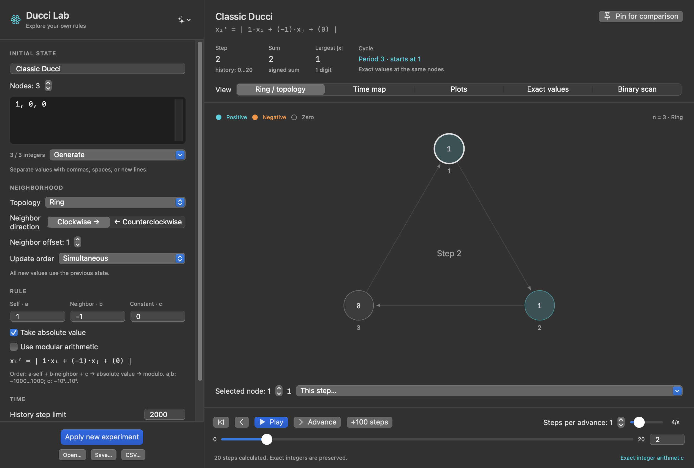
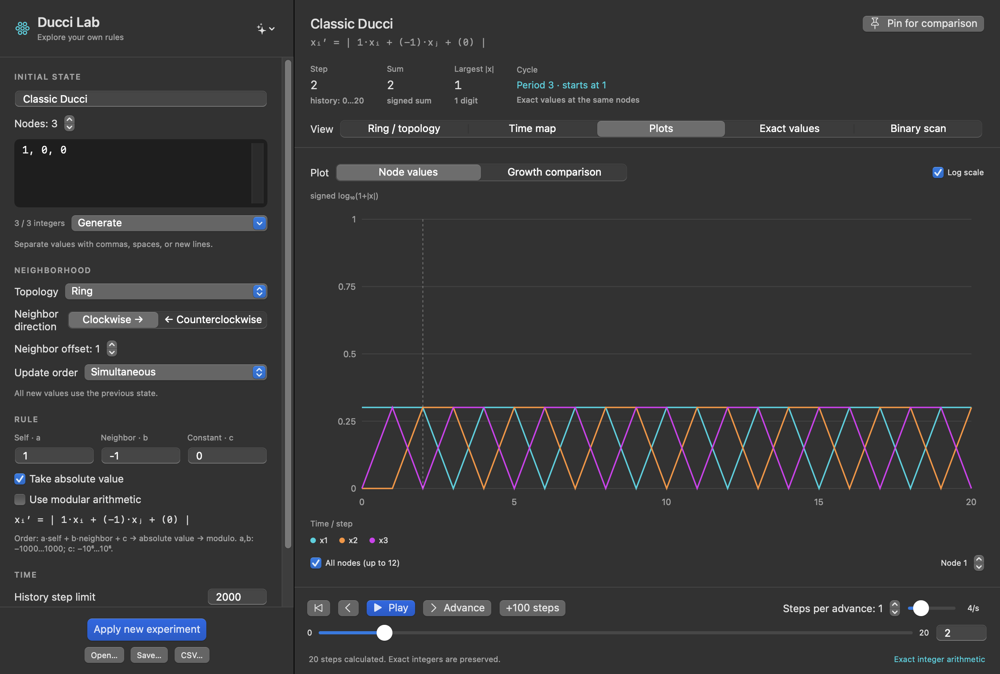
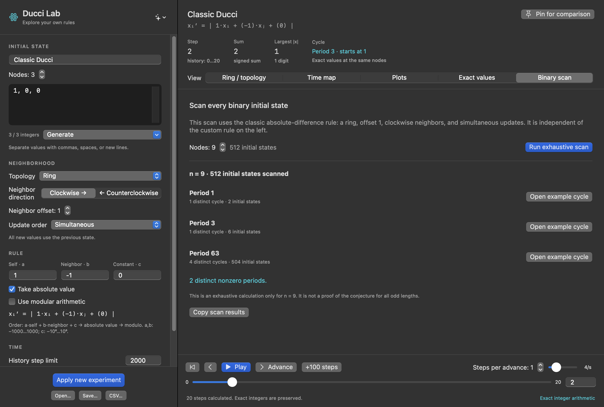

# Ducci Lab

A native macOS laboratory for Ducci sequences and integer dynamics. Change the rule, initial state, topology, and update order, then inspect a ring, time map, plots, or exact integers.

[Download the Mac app](https://github.com/denizybd/ducci-lab/releases/latest) · [User guide](docs/USER-GUIDE.md) · [Mathematical notes](docs/MATHEMATICS.md)



## Explore

- **Custom rules:** `a·self + b·neighbor + c`, followed by optional absolute value and modulo operations.
- **Neighborhoods:** 2–128 nodes, clockwise or counterclockwise neighbors, and an adjustable offset. Use a ring or a line with zero, clamped, or reflected boundaries.
- **Update orders:** simultaneous updates or in-place sweeps in either direction.
- **Time controls:** single or multiple steps, playback speed, history scrubbing, and stopping at the first repeated state.
- **Five views:** ring/topology, a node-time heatmap, value and growth plots, exact values, and exhaustive binary scans.
- **Experiments:** pin four reference runs, branch from a recorded state, save reproducible JSON recipes, and export exact CSV data.

The recurrence uses signed arbitrary-precision integers. Floating point is used only for visual projections. Cycle detection compares complete, exact states, including node order.

## Install

The prebuilt release requires **Apple Silicon and macOS 14 or later**. It has no runtime dependencies and works offline.

1. Download `Ducci-Lab-1.1.0-macOS-AppleSilicon.zip` from [Releases](https://github.com/denizybd/ducci-lab/releases).
2. Extract the archive and move **Ducci Lab.app** to Applications.
3. Open the app.

Release bundles are ad-hoc signed and are not notarized. SHA-256 checksums are included with each release.

## Try the two basic rules

Open the presets menu in the top-left corner and select **Classic absolute difference**. With initial state `(1,0,0)`:

```text
(1,0,0) → (1,0,1) → (1,1,0) → (0,1,1) → (1,0,1)
```

There is one transient step and a cycle of period 3. Select **Signed difference** to keep negative results:

```text
(1,0,0) → (1,0,-1) → (1,1,-2) → (0,3,-3) → …
```

Change settings on the left and click **Apply new experiment**. Draft edits are marked until applied. To compare growth, pin a run, start another experiment, then open **Plots → Growth comparison**.



## Exhaustive binary scans

Enumerate all `2^n` initial states for `n = 2…18` under the classic, simultaneous, offset-1 absolute-difference ring. Inspect the periods, distinct cycle counts, and how many initial states lead to each period. Open example cycles directly.

The scanner is independent of custom rule settings. A complete finite scan is evidence for the selected length, not a proof about all lengths.



## Build and verify

Requires macOS, Swift 5.9 or later, and a macOS 14 or later SDK. No third-party packages are required.

```sh
git clone https://github.com/denizybd/ducci-lab.git
cd ducci-lab
zsh scripts/build-app.sh
.build/release/DucciChecks
codesign --verify --deep --strict "dist/Ducci Lab.app"
```

The app is built at `dist/Ducci Lab.app`. Run the app-owned UI smoke check in an isolated QA directory:

```sh
DUCCI_QA_DIR="$PWD/qa" "dist/Ducci Lab.app/Contents/MacOS/DucciLab" --ui-smoke
```

Checks cover exact arithmetic, rule variants, growth identities, cycle detection, JSON reproducibility, CSV export, exhaustive scans, and compatibility with version 1.0 experiment files. The UI check exercises five views and a compact window, and saves PNG captures. It does not replace independent mouse/keyboard testing.

## Saved data and limits

Your last experiment is stored locally at `~/Library/Application Support/DucciLab/last-experiment.json`. Recipes contain the rule, initial values, generated step count, selected step, and pinned references. Results are regenerated on import. English releases read older Turkish identifiers; user-authored experiment names are preserved.

Storage limits stop a calculation before excessive growth consumes memory. Existing results are retained without silently rounding integers. See the [user guide](docs/USER-GUIDE.md#limits) for limits and visualization sampling rules.

## Source layout

| Path | Purpose |
|---|---|
| `Sources/DucciCore` | Exact integers, recurrence, cycles, recipes, binary scans |
| `Sources/DucciLab` | SwiftUI/AppKit interface and local persistence |
| `Sources/DucciChecks` | Mathematical and compatibility checks |
| `scripts` | Native bundle, icon, release packaging |
| `docs` | User guide, mathematical notes, screenshots |

Created by [denizybd](https://github.com/denizybd).
